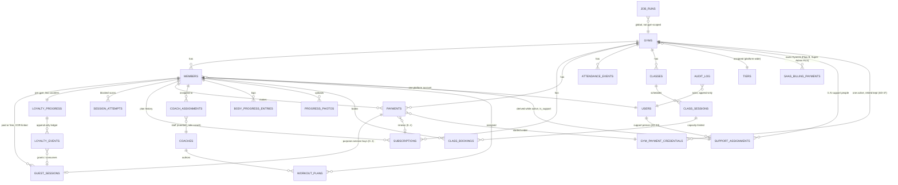

# Architecture Spine — gym_os

## Design Paradigm

Supabase-native: Postgres RLS is the *only* tenancy/authorization boundary — there is no app-side API gateway or repository layer re-implementing it. Three Next.js/Expo apps (dashboard, super-admin, mobile) talk to Postgres directly via `supabase-js`, through a thin per-domain service layer that performs no authorization logic of its own. The two points that genuinely need swappable external vendors (payments, messaging) are isolated behind Hexagonal ports (`PaymentProvider`, `OtpDeliveryProvider`, `WhatsAppMessageProvider`) — everywhere else, the pattern is deliberately *not* applied, since RLS already owns the one boundary that matters.

## Invariants & Rules

### AD-1 — RLS is the sole tenancy/authorization layer [ADOPTED]

- **Binds:** all
- **Prevents:** a second, driftable copy of tenancy/role logic in application code (repository pattern, app-side gateway)
- **Rule:** every table enables RLS with a deny-all default in the same migration as its `CREATE TABLE`. A `STABLE` helper (`private.gym_id()`) is reused across all tenancy checks. Explicit per-action (SELECT/INSERT/UPDATE/DELETE) policies per table, never `FOR ALL`.

### AD-2 — JWT custom-claims hook, canary-tested [ADOPTED]

- **Binds:** all auth
- **Prevents:** the hook's failure mode (silent deny-all) going undetected
- **Rule:** the claims hook is a `SECURITY DEFINER` Postgres function (`custom_access_token_hook`), never an HTTP Edge Function. A CI canary test asserts a known test tenant sees a non-zero, correctly-scoped row count on every run.

### AD-3 — Role/status authorization reads live state, not the JWT claim

- **Binds:** every RLS policy *and every `SECURITY DEFINER` function* that gates on role or gym status (existing and future) — not RLS policies alone; Epic 9 (FR-089/FR-090), Epic 11 (NFR-018, suspended-gym denial)
- **Prevents:** a demoted-but-not-logged-out staff member, or a member of a just-suspended gym, retaining stale access — the window "next token refresh" leaves open. Also prevents the specific regression AD-6 would otherwise inherit: `log_audit_event()` (`0007_audit_log.sql:191`) currently reads `auth.jwt() ->> 'app_role'` directly inside a `SECURITY DEFINER` body, exactly the pattern this AD retires — any new `SECURITY DEFINER` function (`create_staff_member()`, `update_staff_role()` per AD-6) must call the new helper, not copy that existing call site.
- **Rule:** a new `STABLE` helper, `private.current_member_role()`, performs a live lookup against `members` (scoped by `auth.uid()` + `private.gym_id()`); a second helper, `private.current_gym_status()`, does the same against `gyms.status`. Both are called on every RLS evaluation and from inside every `SECURITY DEFINER` function that currently branches on `auth.jwt() ->> 'app_role'` — including the pre-existing `log_audit_event()`, which this AD requires updating, not just new code. Role/deactivation/gym-suspension changes take effect on the very next query, no refresh required. `gym_id` itself stays claim-derived (the accepted multi-gym-membership resolution below is unaffected). A CI grep-lint gate forbids new `auth.jwt() ->> 'app_role'` call sites in `supabase/migrations/`, mirroring the existing i18n hardcoded-string lint gate's shape (fails the PR, not just a review-checklist item) — **Status (2026-10-11, verified):** the gate is specified but **not built** — no CI step greps for it, and 52 migration files now carry the call, including new sites in 0098–0102 added after this AD was written. Building the gate (with an explicit grandfather list of the 52 files) is a prerequisite for the V1.6 migrations, not a follow-up; AD-27, AD-29, AD-30 and AD-32 all depend on the live-role helper and have no other mechanical guard.

### AD-4 — Multi-gym membership resolution: explicit preference, most-recent fallback [ADOPTED, amended 2026-10-11]

- **Binds:** the claims hook, the gym switcher, any suspended-gym screen
- **Prevents:** undefined behavior when one user holds `members` rows at more than one gym; a switcher that trusts a client-supplied gym id
- **Rule:** the claims hook honors `users.active_gym_id` when it names a non-deactivated binding of that user, else falls back to the most-recently-created non-deactivated `members` row. `active_gym_id` is written only by the validated `switch_active_gym()` RPC (Story 9.6, 0065). The list of a user's gyms comes from `list_own_active_gym_memberships()` (0074), the one read allowed to cross the current gym's suspension gate. Loyalty, sessions, and registration-fee state are per member row, hence per gym — never joined across a user's gyms.

### AD-5 — Super Admin escalation is explicit and audit-logged, never a blanket bypass [ADOPTED]

- **Binds:** Super Admin surfaces, FR-072
- **Prevents:** Super Admin's platform-wide role silently reading gym-scoped data outside the escalation flow
- **Rule:** cross-gym aggregates go through `SECURITY DEFINER`, aggregate-only functions (`platform_metrics()`, `gym_member_count()`) that self-enforce `private.is_super_admin()` internally — never a broadened row-level SELECT policy. Row-level access to a specific gym's data requires the audit-logged escalation action (FR-072).

### AD-6 — Staff creation/role-ceiling: one canonical RPC pair, plus a service-role account-creation step

- **Binds:** Epic 9 (FR-087, FR-089, NFR-013)
- **Prevents:** the "caller cannot create/edit an equal-or-above role" rule drifting between the creation and edit/self-edit call sites; a second, divergent staff-activation UX
- **Rule:** `create_staff_member()` / `update_staff_role()` are `SECURITY DEFINER` RPCs that internally check caller-role-vs-target-role against a hard allowlist via `private.current_member_role()` (AD-3) — never a copy of `log_audit_event()`'s stale `auth.jwt() ->> 'app_role'` read. Hierarchy: `Owner → Supervisor → Manager → Receptionist → Coach → Member` (new `member_role` enum value: `supervisor`). Owner creates Supervisor/Manager/Receptionist/Coach; Supervisor creates Manager/Receptionist/Coach only (never Supervisor/Owner); **Manager creates nothing** — the RPC's allowlist has no row granting Manager any target role. This RPC pair is *not* the same shape as Story 1.5's Super-Admin gym/owner creation (that one bypasses RLS entirely as Super Admin); it runs inside the caller's normal Owner/Supervisor RLS session, with the ceiling check in the function body. Only the second step reuses a prior shape: because Postgres functions cannot call the Supabase Auth Admin API, a passing ceiling check gates a Server Action that then calls `supabase.auth.admin.createUser` via the service-role admin client, mirroring Story 1.5/1.11's account-creation step specifically (not their authorization model). New staff activation reuses Story 1.11's existing temp-password-over-WhatsApp mechanism; no second activation flow.

### AD-7 — No repository pattern; thin per-domain service layer [ADOPTED]

- **Binds:** all three apps
- **Prevents:** an app-side copy of authorization rules that RLS already owns
- **Rule:** `services/<domain>.ts` per app wraps `supabase-js`, typed via `packages/types`. Not shared across apps (Next.js and Expo use `supabase-js` in different runtime contexts).

### AD-8 — No custom REST/GraphQL API surface [ADOPTED]

- **Binds:** all three apps
- **Prevents:** a second authorization boundary competing with RLS
- **Rule:** apps call Supabase directly via `supabase-js`/`@supabase/ssr`. Operations with business logic beyond CRUD go through Next.js Server Actions, never raw client-side inserts.

### AD-9 — Server Actions/service functions return `{ data, error }`, never throw for expected errors [ADOPTED]

- **Binds:** all three apps
- **Prevents:** silent divergence on "throw vs. return" across independently-written call sites
- **Rule:** only genuine bugs throw (caught by Sentry). Expected, user-facing errors return `{ data: null, error: { code, message } }`.

### AD-10 — Swappable external integrations sit behind a provider-interface port, isolated to their seam [ADOPTED]

- **Binds:** payments, OTP delivery, general messaging
- **Prevents:** vendor lock-in at the one or two points where a Cameroon-market vendor is genuinely likely to be swapped or fail
- **Rule:** `PaymentProvider`, `OtpDeliveryProvider`, `WhatsAppMessageProvider` own the call contract only; entity shapes stay the generated type from `packages/types` so an interface can't silently redeclare and drift from the schema. Applied *only* at these seams — not a general architectural style.

### AD-11 — OTP delivery is an ordered runtime fallback chain [ADOPTED, 2026-08-08]

- **Binds:** `send-sms-hook`, any future `OtpDeliveryProvider` implementation
- **Prevents:** a new call site re-introducing single-provider coupling; Evolution API's availability gating OTP delivery
- **Rule:** `EvolutionApiProvider → TwilioWhatsAppProvider → TwilioSmsProvider → SentDmProvider`, all implementing `OtpDeliveryProvider`. Chain advances only on failure (network error, non-2xx, or `DeliveryResult.success:false`); first success short-circuits; every attempt logged. `EvolutionApiProvider` requires its own passed sandbox spike (Story 2.9) before joining the production chain — a spike failure leaves the existing 3-provider chain as the production path.

### AD-12 — `WhatsAppMessageProvider`: a second, narrower interface for free-text sends [ADOPTED, 2026-08-08]

- **Binds:** member invitations (FR-082), any future non-OTP send
- **Prevents:** forcing free-text sends through `OtpDeliveryProvider`'s code+locale-shaped contract
- **Rule:** `send(phone, message, locale) → DeliveryResult`. V1.5 ships `EvolutionApiMessageProvider`, called from a Server Action (`sendMemberInvite`), following the established Deno→Node porting precedent (`sendTempPasswordMessage.ts`). Adds no new Edge Function. Backed by a new platform-wide `messaging_provider_config` table (mirrors `tiers`' shape: one row, Super-Admin SELECT/UPDATE RLS, `log_audit_event`-audited writes) storing the active Evolution API instance ID — `send-sms-hook` and `sendMemberInvite` both read it via their service-role clients; updatable without a redeploy when a connected number disconnects.

### AD-13 — Payment provider is DB-row + RPC-driven runtime switching, not an env var [ADOPTED]

- **Binds:** payments (Flow A)
- **Prevents:** requiring a redeploy to switch the active payment provider
- **Rule:** `payment_providers` table, exactly-one-active enforced via a partial unique index (`idx_payment_providers_one_active`); the only write path is `activate_payment_provider()` (`SECURITY DEFINER`) — no direct INSERT/UPDATE/DELETE RLS policy for any role. `active_payment_provider()` is the one narrow read every gym-scoped session gets.

### AD-14 — SaaS billing (Flow B) is a separate table and RLS audience from member payments (Flow A)

- **Binds:** Epic 11 (FR-124–138); Epic 4's reconciliation job (FR-036/FR-137)
- **Prevents:** every existing Flow-A-only RLS policy and reconciliation query from needing a `flow`/nullable-`gym_id` branch it doesn't otherwise need, for two flows whose audiences are already fully disjoint; Epic 4's and Epic 11's independently-scheduled reconciliation jobs (AD-19: each cron job is its own independent transaction) silently disagreeing on what "discrepancy" means since they now touch different tables
- **Rule:** a new `saas_billing_payments` table, Super-Admin-scoped RLS, distinct from gym-scoped `payments`. `PaymentProvider` gains a discriminated routing context — `{type:'gym', gym_id}` selects a gym's Vault-stored Tara Money credentials, `{type:'platform'}` selects GymOS's own — at initiation, verification, and reconciliation. Mirrors the existing `job_runs`/`audit_log` precedent of platform-level concerns getting their own table rather than a nullable `gym_id` bolted onto a gym-scoped one. The single shared `payment-webhook` Edge Function dispatches on the routing context carried in the webhook's own reference/metadata (not a second Edge Function) to decide which table a given event resolves against; `payment_webhook_events` stays one shared log table (events are the DB-idempotency boundary regardless of flow) rather than splitting per-table. Both jobs' discrepancy detection (the 4-category classification from FR-036/FR-137, including the wrong-account-settlement category) is implemented as one shared function/module called by both cron jobs — the separate-table decision must not become a separate, silently-drifting discrepancy-semantics decision.

### AD-15 — Per-gym payment credentials are Vault-encrypted [ADOPTED, 2026-08-11]

- **Binds:** Epic 11's "connect payment account" flow (FR-126)
- **Prevents:** a second, app-layer encryption scheme when Supabase already ships one
- **Rule:** per-gym Tara Money credentials are stored in Supabase Vault — chosen over pgsodium/app-layer encryption as the least code to own and maintain.

### AD-16 — Money is integer + currency column, never a float [ADOPTED]

- **Binds:** all payment/subscription tables
- **Prevents:** floating-point rounding error in financial data
- **Rule:** XAF (and any future currency) stored as integer minor units with an explicit currency column.

### AD-17 — Webhook processing is idempotent [ADOPTED]

- **Binds:** `payment-webhook`
- **Prevents:** a duplicate webhook delivery double-processing a payment
- **Rule:** every webhook event is logged to `payment_webhook_events` before being acted on; signature verification (NFR-002) happens before any DB write.

### AD-18 — Subscription lifecycle is a four-state machine driven by a scheduled job [ADOPTED]

- **Binds:** subscriptions
- **Prevents:** ad hoc, scattered expiry logic across call sites
- **Rule:** `active → expiring_soon → grace_period → expired`, transitions owned by one `pg_cron` job. Grace period is gym-configurable (platform default 3 days). No proration on mid-cycle tier change (OQ-15) — the new price applies at the next billing cycle. A loyalty reward (AD-30) extends `expires_at` by R days inside the renewal-verifying transaction; it is not a state transition, and the job re-derives state from the extended date on its next run.

### AD-19 — Independent scheduled jobs, one table for job observability [ADOPTED]

- **Binds:** all `pg_cron` jobs
- **Prevents:** one job's failure silently blocking or corrupting another; a job queue's added complexity with no retry-with-backoff requirement to justify it
- **Rule:** each cron trigger is its own function/transaction, each logs to `job_runs` (job_name, started_at, finished_at, status, error). No shared trigger; no external job queue (BullMQ/graphile-worker) for this project's scale.

### AD-20 — Realtime has an explicit degrade path [ADOPTED]

- **Binds:** the front-desk alert panel and any future live dashboard surface
- **Prevents:** a retention-critical alert failing silently while the gym believes the safety net still exists
- **Rule:** dashboard falls back to short-interval polling if the Supabase Realtime channel drops.

### AD-21 — Bounded-capacity actions are a row-locked check-then-insert RPC, not a bare insert or a uniqueness index

- **Binds:** Epic 12 class booking (FR-105), class attendance (FR-107)
- **Prevents:** overbooking under concurrent requests; a second, disconnected source of truth for "did this member attend" once class attendance exists alongside floor check-in
- **Rule:** `book_class_session()` is a `SECURITY DEFINER` RPC that `SELECT ... FOR UPDATE`-locks the `class_sessions` row, counts existing bookings, and inserts only if under capacity — one atomic transaction, self-checking caller role/tenant like `check_in()`/`confirm_renewal()` already do. Distinct from the one-open-check-in invariant (AD-22): that is a 0-or-1 uniqueness constraint; this is a bounded count, which a partial unique index cannot express. Class attendance (a Receptionist marking a booked member present, FR-107) is an `attended_at` timestamp on `class_bookings` (0068 deviated from the original 'status column' wording), never a write to `attendance_events`/`check_in()` — FR-107 explicitly treats class attendance as distinct from floor check-in while reusing the same member-status rules (expired members can't be marked attended, and it triggers the same front-desk alert, FR-049); `attendance_events` remains floor-check-in-only. At a charging gym (V1.6), marking a Pay-per-session guest attended additionally calls the shared consumption function of AD-29 — it shares that function, never the `attendance_events` write. **Flagged as extrapolation from precedent, not a proposal-sourced decision** — confirm the RPC-vs-lighter-mechanism call during Epic 12 story-writing.

### AD-22 — One-open-check-in-per-member is a partial unique index [ADOPTED]

- **Binds:** attendance
- **Prevents:** a member holding two simultaneous open check-ins
- **Rule:** `idx_attendance_events_one_open_per_member`, a partial unique index — the DB-level enforcement of record, not an app-side pre-check alone.

### AD-23 — Offline support is scoped per-domain, each its own idempotent queue-item type — not a generic action queue [ADOPTED, extended]

- **Binds:** mobile check-in (V1.0), workout-completion logging (V1.5, FR-110)
- **Prevents:** queuing a generic action whose conflict-resolution rule is undefined (the V1.0 rationale this AD preserves — payments, class bookings, or any other stateful/capacity-checked action still do **not** get offline queueing)
- **Rule:** each offline-capable action is its own explicit, `client_id`-keyed queue-item type with its own conflict-resolution rule (check-in: timeout backfill; workout completion: idempotent upsert, no backfill concept needed). A queued guest check-in at a charging gym (FR-161) is a check-in item whose server-side outcome may now be *denied-and-recorded as an attempt* (AD-31) rather than backfilled; the queue item is complete either way, never retried. Class booking (AD-21) is explicitly excluded — its synchronous, row-locked capacity check has no offline-queueable equivalent; a queued booking could not honor `book_class_session()`'s atomicity guarantee. The mobile app's existing SQLite offline-queue infrastructure is reused, not duplicated, for the second item type. **Flagged as extrapolation from precedent, not a proposal-sourced decision** — confirm during Epic 13 story-writing.

### AD-24 — Progress photos live in a dedicated private bucket, never the public one [ADOPTED]

- **Binds:** Epic 10 (NFR-011)
- **Prevents:** copy-pasting the existing `member-photos` bucket's `public = true` setting onto a domain that needs per-photo, revocable consent
- **Rule:** a new Storage bucket, private, signed URLs, non-guessable paths. Per-photo coach-sharing consent (FR-095): default-off, immediate-revoke, non-retroactive viewing history — revocation invalidates any already-issued signed URL for that photo (short TTL, re-verified per photo), not just future issuance.

### AD-25 — Push notification dispatch is DB-triggered, not a service-layer responsibility [ADOPTED]

- **Binds:** all push notifications (N-01 through N-05 shipped; N-06/N-07 quiet-gym-alert and class-reminder extensions land under this same mechanism, Epic 6)
- **Prevents:** notification-sending logic scattering into individual Server Actions/service functions, each a separate place to get delivery/retry/token-cleanup wrong
- **Rule:** the `pg_net` Postgres extension calls Expo's Push API directly from a `send_push_notification()` Postgres function, invoked by cron jobs (subscription-lifecycle) and `AFTER INSERT/UPDATE` triggers (payments). Stale push-token cleanup happens in the same function on delivery failure. No new Edge Function — keeps AD's Edge-Function-count-is-a-design-property intact (Structural Seed).

### AD-26 — Member-cap enforcement is a DB trigger backstop, with a fast-fail duplicate check in the Server Action [ADOPTED]

- **Binds:** member creation and invitation (FR-086, Epic 9's staff creation is exempt — staff don't count against a gym's member cap)
- **Prevents:** any client-side-only cap check being bypassable; a slow, unfriendly failure at the DB layer for the common case
- **Rule:** a `BEFORE INSERT` trigger on `members` comparing active+deactivated count against the gym's tier cap (`tiers.member_cap`, nullable = unlimited; `gyms.member_cap_override`, nullable = use tier's own cap) is the enforcement of record — cannot be bypassed by any client. `createMember`'s Server Action performs the same check first for a fast, friendly failure before ever reaching the trigger; the trigger is the backstop, not the only line of defense.

### AD-27 — `payments.purpose` is a closed set, completed in one dispatcher [ADOPTED for `subscription`/`registration_fee`; `session` new in V1.6]

- **Binds:** registration fee (FR-152, shipped 0099–0101), session payments (FR-158, FR-162), every renewal path
- **Prevents:** a third payment kind being treated as a renewal by an unaware code path; per-purpose side effects scattered across webhook, RPCs, and triggers; two purposes quietly inheriting each other's late/duplicate rules
- **Rule:** `payments.purpose ∈ {subscription, registration_fee, session}`. Adding `session` amends, in one migration: the CHECK, the `protect_payment_purpose_and_void` pin, the staff-insert policy clause, the notification-trigger skip (a session payment sends no renewal push), and the revenue line (FR-143, FR-162 — its own line). Each purpose's effect lives in one shared `private.` function (renew / settle fee / create session + stamp), and every completion path — `complete_verified_payment()` for Tara webhooks, plus the manual paths (`confirm_renewal`, the 0031 staff-verify policy, the desk RPCs) — calls that function rather than re-implementing it; `complete_verified_payment()` branches on `purpose` and never falls through. **Late-confirmation rules are per purpose and intentional:** a late registration-fee confirmation is *not* applied (0100: only rows still `processing` complete; a staff-visible late-payment audit row instead), a late **session** confirmation *is* applied and raises an audit entry (FR-158) — a `session` payment flagged or settled to the wrong account (FR-036, NFR-019) never creates a session. Both outcomes are stored `flagged` today, so a reason discriminator (a column on `payments` or a distinct audit code, decided in the story) is required before the session branch ships — a late-confirmed payment must be distinguishable from a wrong-account one, or the rule cannot be implemented. Desk session payments take effect immediately via a definer RPC whose amount is read server-side from the plan, never passed in. At most one payment in flight per member and purpose is enforced the way 0100 does it for the fee: the initiating definer RPC takes the member lock, first calls the stale-expiry helper (a `processing` row older than ten minutes is flagged, audited, and no longer in flight), then checks — with a partial unique index over `status in ('pending','processing')` as the backstop, not the primary mechanism, because an index alone would wedge a member behind an abandoned row (cf. AD-22). A session payment reuses that helper rather than copying it. **Canonical lock order, everywhere:** `class_sessions` (AD-21) → payment row → member row → `attendance_events` → `subscriptions` → `guest_sessions` → `loyalty_progress`; the member lock is `FOR NO KEY UPDATE`, not `FOR UPDATE`, because a full `FOR UPDATE` on `members` deadlocks against the key-share locks FK inserts take. 0100's `complete_verified_payment` does not lock the member on the subscription path — the V1.6 story that makes it award a stamp must add that lock, and the daily sweep (AD-30) takes the same order per member.

### AD-28 — A session is one record type, `guest_sessions`, never a payment

- **Binds:** FR-158, FR-166, FR-169, FR-173
- **Prevents:** free sessions appearing as payments/receipts/revenue; two tables independently answering "does this member have a usable session"; a plan price change re-pricing sessions already bought
- **Rule:** one row per purchase or grant: `gym_id`, `member_id`, a source linked to **exactly one** of `payment_id` or a loyalty grant (CHECK XOR), `usable_until` (paid: payment + 7 days; free: grant + 60 days — durations from the platform config row, AD-30), `consumed_at`, `covered_day` (gym-local `date`, written at consumption and never recomputed), `voided_at`. Value is the amount of the linked payment, never the plan's current price. RLS: staff and the member read their own gym's rows; no role has a direct write policy — creation, consumption, void, and lapse are definer functions only. Refunds are direct inserts into `refunds` today, so the void/stamp-reversal rule (FR-162) is an `AFTER INSERT` trigger on `refunds` for `purpose = 'session'` payments (data layer, as FR-153 does for the fee), not a service-layer step. A refund that fully voids an unused session and a consumption that races it resolve under the member lock (AD-29) to exactly one outcome.

### AD-29 — Session consumption is one function under one member lock

- **Binds:** `check_in()` (online and offline-sync paths), class attendance marking (FR-174, AD-21), FR-159, FR-161, NFR-021
- **Prevents:** the dashboard, coach roster, sync, and member app each implementing "covered today?" with different clocks or different locks; an older app build bypassing the rule; a concurrent scan consuming a second session
- **Rule:** `private.consume_guest_session(member_id, gym_id, receipt_at)` takes `SELECT … FOR UPDATE` on the member row, then returns *covered*, *consumed*, or *denied*. It is called by `check_in()` and by class-attendance marking — and by nothing else. Because `attendance_events` and `class_bookings` currently grant direct INSERT/UPDATE/DELETE to `authenticated` and `service_role` (0006, 0058) and `service_role` bypasses RLS, the V1.6 migration revokes those direct write grants (after a grep for existing service-role writers) so the definer functions are the only write path; `mark_class_attendance()` gains an `attended_at is null` guard so a re-mark consumes nothing, and a partial unique index on `guest_sessions (member_id, covered_day) where consumed_at is not null` backs "one session per gym-local day" in the data layer. It applies only when the gym's charging flag is on **and** the member's current plan is Pay-per-session. Selection order: soonest-lapsing first, paid before free on tie. **Server receipt time governs** coverage, lapse and stamps; a client scan time is honored only for an offline scan within the gym's auto-timeout window (FR-045) and can never move a visit before its payment. "Day" is always `private.gym_local_day_bounds(gym timezone, at)` (0097), never UTC truncation. **Denial keeps the shipped `check_in()` contract**: it already returns `attendance_events` and signals "blocked, no event" with `null` (the expired-member branch, 0034/0090) while recording an alert; a session denial does the same — same signature, same `null`, no new result type — so older builds stay safe: the mobile client (`checkin.ts`) maps `null` to its `expired` outcome, so a denied guest is **not admitted** but sees expiry copy, not session copy — accepted for old builds. The current build's story must map a null result at a charging gym to the session-required state by reading the latest attempt (AD-31), and must not add a coded row to the return type (an old build would read any non-null row as success). The *reason* (session required) is read from the attempt/alert row (AD-31), never from the return value. Gym-not-active remains the one raised exception (0090). The stamp (FR-165) is awarded by this function's own call to `private.award_session_stamp()` (AD-30) inside the same lock and transaction — not by the caller. A Pay-per-session plan priced at 0 XAF is exempt (FR-156): the function returns *covered* without a session. Class attendance still never writes `attendance_events` (AD-21) — it shares only this function; `mark_class_attendance()` keeps its own signature and surfaces the same denial as a `{ code, message }` error (AD-9).

### AD-30 — Loyalty is an append-only ledger, written in the earning transaction

- **Binds:** FR-164–FR-170, NFR-022; every renewal-verification path (`confirm_renewal`, `renew_subscription`, `complete_verified_payment`, and the staff verification-queue path of 0031 — the story must enumerate by grep, not from this list)
- **Prevents:** a stamp granted twice under webhook redelivery or sync replay; the subscriber-stamp rule living in three renewal paths that drift; a balance anyone can hand-edit; progress shown live after its window
- **Rule:** `loyalty_events` is append-only (`stamp_earned`, `reward_granted`, `reward_consumed`, `reset`, `lapse`, `stamp_reversed`), unique-keyed on `(origin_id, event_type)` — the originating event being the consumed `guest_sessions.id` or the verified renewal `payment_id` — so one origin can legitimately yield a stamp, a reward, and a reversal but never two of the same so a replay inserts nothing. `loyalty_progress` (one row per member per gym, two counters — guest, subscriber) is derived and written only by the definer functions below, in the same transaction as the event that earns it. Subscriber stamps are awarded by **one** `private.award_renewal_stamp()` called from every renewal-verification path, evaluating on-time-ness (end of the day after expiry, gym-local) at verification, not initiation; the K-th reward extends the renewed subscription's expiry by R days in that same transaction and creates no payment. No role — Super Admin included — has any write path to either table other than those functions (FR-170); programme parameters (N, K, R) change only through the AD-32 setter. The 90-day reset and 60-day validity are platform defaults held as data on a platform config row (mirrors the `tiers` / `messaging_provider_config` shape, AD-12), not constants. A single `effective_loyalty(member_id)` read function (window-aware, per gym) is the only source for the member app (FR-169) and the dashboard member page — no client recomputes it. A refund recorded against a session payment (FR-162) calls `private.reverse_session_stamp()` from the same refund-recording function that voids/keeps the session (AD-28), in one transaction; the counter floors at 0 and never revokes a granted free session. **[ASSUMPTION]** resets, free-session lapses and unused-paid-session lapses are *persisted and audited* by a daily `pg_cron` sweep (AD-19, its own `job_runs` name), while every read computes the effective value and never writes — so a read is never a mutation and a past-window balance is never shown as live.

### AD-31 — Blocked attempts are evidence; the front-desk alert is only a notification

- **Binds:** FR-160, FR-161, FR-163, FR-174; AD-20, AD-25
- **Prevents:** blocked-attempt figures read from `front_desk_alerts` (rows dismissed on payment, so counts shrink); the new alert type breaking the existing CHECK and one-active-per-member index; a retried offline scan counted twice
- **Rule:** a `session_attempts` table (gym_id, member_id, scan id, occurred_at, source `check_in`|`class`) is unique on `(gym_id, member_id, scan_id)` where `scan_id` is not null and is the *only*. `scan_id` is the client scan id: online `check_in()` calls usually carry none, so each such denied scan is one attempt (a retry is a person trying again), and class marking has no client scan id, so the marking function generates one per action — dedup (FR-160) therefore applies to offline-synced scans, where it matters. It is the *only* source of the Guest-sessions card's blocked counts (server-side aggregate, FR-143's `max_rows` caveat). The alert is a `front_desk_alerts` row discriminated by a new `kind` column (existing rows backfilled `subscription_status`). `status` becomes nullable and its CHECK becomes `(kind='subscription_status' and status in (…three values…)) or (kind='session_required' and status is null)`; the one-active unique index is rebuilt over `(member_id, kind, coalesce(status,''))`. **The index swap and the rewrite of every `ON CONFLICT (member_id, status)` clause ship in one migration** or alert creation errors — the sites are in 0034, 0068 and 0090 (three), found by grep, not from this list. `front_desk_alerts_protect_columns` is extended to pin `kind`, and every dashboard alert query/panel filters or branches on `kind`. The row is created in the same transaction as the denial and dismissed by the session-payment definer function. Delivery reuses AD-20's channel and degrade path — no new channel, no new Edge Function.

### AD-32 — Audited gym settings have exactly one write path each

- **Binds:** `registration_fee` (FR-147, shipped), `charge_guests_per_session` (FR-157), loyalty enabled/N/K/R (FR-164), `category` (FR-171); the Settings page and Super Admin Create Gym
- **Prevents:** an Owner's direct `UPDATE gyms` (policy `owner_update_own_gym`) bypassing a role gate, audit entry, or confirmation count; a setting whose audit shape or role set differs between Settings and Super Admin
- **Rule:** each setting is written only by its own `SECURITY DEFINER` setter RPC (the `set_registration_fee()` shape, 0098) that checks role via `private.current_member_role()` (AD-3 — 0098's own setter reads the JWT `app_role`, grandfathered; new setters must not copy it), writes the audit row with old and new value, and is the sole holder of that setting's own GUC. **Each new setting gets its own BEFORE UPDATE pin trigger function** — not another branch in `protect_super_admin_only_gym_columns()`, which parallel stories would each `CREATE OR REPLACE` whole, the last writer silently dropping the others. Pinned against every writer except its setter; the `category` setter explicitly admits Super Admin (FR-171). Defaults are set at migration time: `charge_guests_per_session` is added `NOT NULL DEFAULT false` (existing live gyms stay off), then `ALTER COLUMN … SET DEFAULT true` for gyms created afterwards — a single `ADD COLUMN … DEFAULT true` would switch charging on for every live gym at deploy; loyalty defaults off; registration fee 0. `category` is stored as a stable code (never a label; EN/FR labels live in `packages/types`), set at Super Admin gym creation and editable by Owner/Supervisor through its setter. Turning charging on affects only visits from that moment and never touches an open check-in. FR-173 follows the same rule: a plan's type and price change only through a definer RPC that refuses a type change once the plan has subscriptions and audits every type/price change with old and new value; direct `UPDATE plans` for those columns is pinned.

### AD-33 — Support is its own member role, derived from one assignment record

- **Binds:** FR-175–FR-178, FR-182, FR-183, FR-188, FR-193, FR-194; every surface that lists staff, counts staff, enforces a cap (AD-26), fans out notifications (AD-25), or aggregates metrics
- **Prevents:** a support person passing every existing Supervisor policy and RPC by default; the assignment, the membership and the opt-out becoming three sources of truth; each surface growing its own "exclude support" filter; one person acting as both Super Admin and support
- **Rule:** a new `member_role` value, `support`, distinct from `supervisor`. No existing policy or RPC lists it, so support is **denied by default**; access is opt-in per policy and RPC, through the AD-35 registry. `support_assignments(support_user_id, gym_id, state, …)` with state `pending | active | suspended | ended` is the source of truth; the `members` row (`role = 'support'`) exists only while the assignment is `active`, written only by one `SECURITY DEFINER` function. Invariant, tested: active support membership ⇒ assignment `active` AND `gyms.allow_gymos_support`. That function also owns creation checks (FR-175, FR-193): phone and email on file matched against every Super Admin and every existing user and refused on a match; email must be an `@gymosapps.com` address (format only until mailboxes exist); a Super Admin session cannot be assigned; assignment is refused if the person already has a `members` row in that gym; activation of a `pending` assignment is a Super Admin action. The support membership invariant is **enforced**, not only tested: a constraint trigger on `members` refuses a `support` row without an active assignment and the setting on. Every staff-target predicate written as `role != 'member'` (0062/0063/0064/0090 and any like it) is rewritten to an explicit list of staff roles that excludes `support`, and the staff-management RPCs (`update_staff_role`, deactivate, credential reset, resend) refuse a support target; only the Super Admin path edits a support membership. The support `members` row stores display name "GymOS Support" with no phone and no email, and a RESTRICTIVE select policy hides support rows from every role except Super Admin and the support member itself. One predicate, `private.is_support_member()` (`role = 'support'`), is the only exclusion used by counts, caps, notification fan-out and metrics. `allow_gymos_support` is added `false` for existing rows and set `true` only by gym creation. **Lock namespace:** per-gym advisory locks `gym:<gym_id>:support` and `gym:<gym_id>:credentials` are taken, in that order, before any row lock of AD-27's canonical order; the member-cap trigger's existing key is unchanged and sits after them.

### AD-34 — One live authorization gate, split into a read and a write, on every path

- **Binds:** AD-3 (amended below), AD-4; every RLS policy, RPC, edge function and service-role path a support session can reach; FR-189, FR-192, FR-194, NFR-023
- **Prevents:** a path that skips the second factor or the opt-out because it runs with the service role; removal or a factor reset taking effect at token expiry; a null role passing a negated `= any()` check; the gate's own writes being rolled back by its denial
- **Rule:** *Read:* `private.current_member_role()` (STABLE, AD-3) returns `'support'` only when the assignment is `active`, `allow_gymos_support` is true, the gym is not suspended, the account is activated, not locked and has no factor reset pending, the JWT `aal` is `aal2`, the JWT `session_id` still exists in `auth.sessions`, and the session is within the AD-40 limits; otherwise `NULL`. *Write:* a separate VOLATILE `private.support_gate_touch()` records last-seen and velocity, and a limit breach is **returned as a result**, never raised, so the lock and log commit; denials are logged by the caller. Edge functions and service-role code call one shared `authorize_support_action(actor, gym_id, capability)`, passing the actor explicitly because service-role paths carry no claims. **Amendment to AD-3:** `gym_id` stays claim-derived for every role except `support`; for a support claim, `private.gym_id()` also checks the live assignment, and the claims hook (AD-4) emits `gym_id` and `app_role = 'support'` only for an `active` assignment, and only at `aal2`, `[ASSUMPTION — hook receives aal; verify in the spike]`. A support person's active gym is chosen only by `switch_active_gym()` restricted to active assignments (FR-194). AD-3's CI grep gate is extended with a generated inventory of every policy, function and edge function reading `app_role` or `gym_id` from the claim; any that decides from the claim alone fails the build. For a support user the hook's most-recent-membership fallback (AD-4) is disabled: no gym claim exists until `switch_active_gym(p_gym_id)` names an active assignment, and a hook error omits the claims (fail closed). **The Super Admin app is a path too:** the hook emits `super_admin` at `aal1`, so the app's layout and every Server Action that obtains a service-role client first call one guard, `requireSuperAdminAal2()`, which checks `aal2` server-side while the platform flag is on (AD-38); a service-role client is never constructed before it. A support session reaches data only through registered policies and RPCs (AD-35); reads never refresh `last_seen_at`, so a session that only reads expires at the idle limit, and every registered RPC begins with `support_gate_touch()`. For a support claim `private.gym_id()` takes one indexed lookup `(support_user_id, gym_id) where state = 'active'` through a STABLE definer function that bypasses RLS (no recursion); the first branch returns the claim unchanged for every other role, so the hot path is unaffected. `log_audit_event()` is not callable by a client with a caller-chosen actor or gym. Role comparisons are null-safe. Payment inserts verify that the member belongs to the gym.

### AD-35 — Support capabilities are a registry, opted in per policy and RPC

- **Binds:** FR-179; the AD-32 setters, the AD-6 staff RPCs, the AD-36 payment-connection function, every `SECURITY DEFINER` function a support session may call
- **Prevents:** support reaching a table, column or policy by inheritance; the denied set (tier, interval, billing anchor, Owner contact, suspension, deactivation, `allow_gymos_support`, Owner and Supervisor edits, phone change, credential reset) drifting as new RPCs ship
- **Rule:** `support_capabilities(capability, rpc_name | policy_name)` lists every RPC and policy that admits `support`; adding `'support'` to a policy or function is a registry change, checked by a catalog test that classifies every policy and function mentioning `'supervisor'` as including or excluding support. A pgTAP matrix iterates every RPC and column grant and asserts the denied set. Money-moving and access-changing writes opted in for support (refunds, waivers, payment-connection changes, staff creation) include `private.support_step_up_ok()` in the policy or function (AD-40). Staff created by support are tagged `created_by_support`, the AD-6 allow-list still applies, and **they are not deactivated when the person is revoked**: they are listed to the Owner for review (FR-181).

### AD-36 — A payment-connection change is one audited, step-up-gated function (Owner confirmation dropped 2026-10-15)

- **Binds:** FR-180, AD-13, AD-15, AD-35, AD-40, `gym_payment_credentials` (0052/0054)
- **Prevents:** a payment account being connected or replaced through any path other than the one audited function; secrets left in Vault; first connection being treated differently from replacement; a change that leaves no Owner-visible trace (an Owner **approval** was deliberately not built).
- **Rule:** decided by the product owner 2026-10-15: no proposal table, hash binding, expiry or Owner re-authentication. One `SECURITY DEFINER` function connects or replaces a gym's credentials; it requires `private.support_step_up_ok()` bound to action `payment_connection` and the gym (AD-40) for a support caller. The masked identifier, merchant fingerprint and holder name are **derived from the decrypted secret inside the function**, never supplied by the caller, and the 0083 business-id collision guard runs there. The function runs under the `gym:<gym_id>:credentials` lock (AD-33), writes the Vault secret, retires the previous credential (`retired_at`; never deleted in place) and activates the new row (AD-37). Connect and disconnect in 0052/0054 are rewritten onto this path: disconnect retires the credential. The audit row records that credentials changed, never the value. The Owner is notified immediately (AD-25) and Super Admin is alerted; velocity counts it (AD-41). The residual risk — a compromised or malicious support account redirecting member payments — is mitigated by audit under the individual's identity, the fresh second factor and the velocity lock, and detected rather than prevented.

### AD-37 — Payment credentials are versioned by connection; a payment resolves the one it started under

- **Binds:** payment initiation, verification and reconciliation (AD-13, AD-14), `payment-webhook` (AD-17), `gym_payment_credentials`, `payments`
- **Prevents:** a late webhook, a status check or reconciliation being verified against the wrong account after a swap; cross-account leakage (NFR-019); a swap breaking payments in flight; a write before signature verification
- **Rule:** the unique constraints on `gym_payment_credentials` (`(gym_id, provider_key)` and the business-id uniqueness) become partial unique indexes over active rows (`retired_at is null`), so rolling back to a previous merchant is a new active row. `payments.credentials_id` is recorded at initiation; existing payments are backfilled with their gym's single current row. The webhook resolves credentials by `credentials_id`; when a webhook arrives before the reference exists it matches the business id across the gym's non-deleted credential rows, then sets `credentials_id`. Status checks and reconciliation use `credentials_id`, never `connected_at`. Initiation takes the credentials lock in shared mode and the AD-36 connect-or-replace function in exclusive mode, so initiations do not serialize against each other but wait while it runs; they use the active row only. A business id that matches both a retired and an active row of one gym resolves to the active row. A retired credential stays in Vault, disabled for new initiations, until no payment under it is `pending` or `processing` and at least 7 days have passed, hard cap 14; a job then deletes the secret. A webhook that cannot be verified because its credential is deleted is **rejected (401) before any database write** (NFR-002, AD-17); it is counted in edge-function logs only. Money received after deletion is reconciled by staff against the provider statement.

### AD-38 — TOTP at AAL2 for support and Super Admin, enrolled only through a server function

- **Binds:** FR-176, FR-185, FR-189–FR-191, FR-193; the support sign-in, the Super Admin app, the staff login screen
- **Prevents:** a factor enrolled by whoever holds a first credential or a stolen lower-level session; a reset that leaves a live token; the only Super Admin being locked out
- **Rule:** sign-in for support is **phone + password**, then the TOTP code (AAL2); the email on file is not a sign-in method until verified, which the provider also enforces (an unconfirmed email cannot sign in). Activation is by a single-use invite (hashed, 24 h, bound to the account's verified phone): phone one-time code, set password, enroll TOTP; the account is `activated` only after a verified factor. Factor enrollment and removal for these roles run **only** in a server function that checks the session's `aal` first (a second factor requires `aal2`); the client enroll call is not used for them, and a spike test proves a lower-level session cannot add a factor by calling the provider directly, with a database-level guard if it can. Verifying a factor signs out the user's other sessions; that is accepted at activation and reset. The FR-193 identity checks run at creation, at activation and at every assignment, not once. Super Admin holds exactly two verified factors on separate devices; the AAL2 requirement is a platform flag, `private.is_super_admin()` enforces `aal2` while it is on, support-account creation is refused while it is off, and it is flipped once by a one-time script after both factors verify. Support reset: a Super Admin at AAL2 records an identity check; a 30-minute cooling-off freezes phone and email changes, notifies the phone and the email on file, and offers the person a cancel; then `auth.admin.mfa.deleteFactor` runs, the person's `auth.sessions` are removed, and a new invite issues. There is no in-app Super Admin factor reset: last resort is the platform owner deleting the factors with the service role, a runbook step recorded by hand, until a second Super Admin makes dual control possible. With only the phone verified, the invite and the reset notice share one channel; the compensating controls are the Super Admin's identity check, the cooling-off, and the Owner notifications. Supabase has no native recovery codes, so the second factor is the recovery.

### AD-39 — Attribution is written as a per-gym proxy actor; the real identity is a Super Admin-only record

- **Binds:** FR-182, FR-186, FR-187, FR-195; `audit_log`, every `created_by` / `recorded_by` / `approved_by`-style column, payments, refunds, notes, check-ins, exports, Realtime payloads, notifications
- **Prevents:** a support person's identity reaching any gym-side read, including raw base-table reads and Realtime rows; correlating one person across gyms; a client-supplied display actor
- **Rule:** each gym has one proxy `users` row (`is_support_proxy`, display name "GymOS Support"), created with the gym. When the caller is a support session, a single `private.actor_id()` returns the proxy id and every attribution column and `log_audit_event()` writes it, with `actor_display_name = 'GymOS Support'`; the real person is stored in `support_action_identity(subject_table, subject_id, real_user_id, gym_id)`, readable by Super Admin only. Existing FK shapes are unchanged. Existing writers are enumerated, not only column defaults: a generated inventory over `pg_proc` bodies and triggers (0034/0035/0036/0037/0061/0063/0090/0093/0099/0100/0108/0110/0119/0121, `connected_by` in 0052/0054/0083, and any later one) lists every function that writes `auth.uid()` into an actor column, each must call `private.actor_id()`, and CI fails on an unlisted writer; RLS `WITH CHECK (actor_id = auth.uid())` policies on support-writable tables become `actor_id = private.actor_id()`. Because `users.id` references `auth.users(id)`, each gym's proxy is a banned auth user created through the admin API when the gym is created (gym creation fails closed if it cannot be created) and backfilled for existing gyms by a one-time script; its phone and email are null, and `is_support_proxy` excludes it from every person-level count, notification and export. Support `users` and `members` rows are unreadable to every non-Super-Admin. Realtime channels carry proxy ids only, and support sessions hold no gym Realtime subscriptions (AD-20 degrade path). Signed links issued to support live at most 60 seconds. Exports and Sentry breadcrumbs go through one scrub helper. The staff list and the three Owner states come from one `SECURITY DEFINER` read, `gym_support_status()`, which returns state and last-acted time and synthesizes the single "GymOS Support" row. Member-facing surfaces never join attribution columns for support (FR-195). An Owner's disclosure request is a row in `support_disclosure_requests`, answered by Super Admin outside the product and audited. A per-surface test list is part of the Step 1 gate.

### AD-40 — Session limits and step-up are enforced by the application, from server-recorded state

- **Binds:** FR-189; the AD-34 gate; the AD-36 connect function; Super Admin sessions
- **Prevents:** limits that exist only on a provider plan tier (time-box and inactivity are Pro-plan features); a long-lived AAL2 session moving money without a recent second-factor check; a step-up that depends on token claims the provider does not guarantee
- **Rule:** `support_session_state(session_id, started_at, last_seen_at)` and `support_stepup(user_id, action, subject_id, expires_at, consumed_at)`; the gate (AD-34) denies a session older than 8 hours or idle more than 15 minutes (Super Admin: 8 hours and 30 minutes `[ASSUMPTION]`). Step-up is a server action: the user answers a fresh TOTP challenge, the server verifies it and records a step-up row valid five minutes ahead, **single-use and bound to the action and its subject** (a payment-connection change, a refund, a staff creation); `private.support_step_up_ok()` consumes it. It is keyed to the user, not the session, because verifying a factor can rotate or end other sessions. It does not read the `amr` claim. A factor reset, lock or removal clears `support_session_state` and removes the user's `auth.sessions`. Wrong-code lockout is an application counter that locks the account for Super Admin review.

### AD-41 — Support lifecycle, velocity and Owner visibility are table-driven jobs, each its own cron

- **Binds:** FR-181, FR-184, FR-185, FR-182; AD-18, AD-19, AD-25
- **Prevents:** one job doing inactivity, digest and cleanup together (one failure hiding the others); a suspended gym's support being auto-disabled for inactivity it did not cause; a velocity denial rolling back its own lock
- **Rule:** velocity (10 per hour per gym, 20 per hour per account, 3 payment-connection changes per day per gym `[ASSUMPTION]`) is counted by `support_gate_touch()` and a breach sets `users.support_locked_at` and is returned as a result (AD-34). Independent jobs, each writing `job_runs` (AD-19): `support_inactivity_sweep` (30 days; quarterly recertification due date; suspended gyms excluded), `support_activity_digest` (per-gym daily Owner summary, plus support-created staff awaiting review, through AD-25), `payment_connection_cleanup` (AD-37). When access ends, in-flight work completes or rolls back, and pending items created by the revoked person are re-owned to the gym's proxy actor and flagged for the Owner (FR-184).

## Consistency Conventions

| Concern | Convention |
| --- | --- |
| Naming (DB) | snake_case, plural tables (`members`, `payments`); FKs as `<singular>_id`; indexes as `idx_<table>_<column(s)>` |
| Naming (RPCs / Server Actions) | RPCs snake_case verb_noun (`renew_subscription()`); Server Actions camelCase verbNoun (`createMember`) |
| Naming (code) | Components PascalCase (file name matches); hooks `useX.ts`; shared types PascalCase, defined once in `packages/types` |
| Data shape boundary | `snake_case` for anything that is a DB row shape (matches `supabase gen types` directly); `camelCase` only for pure UI-local state/props that never round-trip to the DB |
| Dates | UTC `timestamptz` in DB and over the wire always; locale formatting only at UI render |
| Booleans | native Postgres `boolean`, never `0`/`1` |
| Soft delete | `deactivated_at` timestamp, never a boolean flag |
| Error shape | `{ code: string, message: string }` — `code` feeds one centralized error-mapping utility; `message` is already-localized EN/FR. Components never hand-write error copy |
| Validation | Zod schemas live once in `packages/types`, consumed by every write boundary (forms, Server Actions, Edge Functions) — never redefined inline |
| Support-reachable functions | Support is its own role (`support`), denied by default. Every policy, `SECURITY DEFINER` function, edge function or service-role path a support session may reach is opted in through the capability registry and calls the gate (AD-34, AD-35); service-role paths pass the actor explicitly. Role checks are null-safe. |
| Function privileges | Every new function: `revoke execute … from public`, `from anon`, and (for service-role-only functions) `from authenticated`, then grant explicitly — the hosted project's default privileges grant EXECUTE to `anon` on new functions (0104 realigned the earlier ones). Stated in the same migration, never assumed from `from public` alone. |
| Realtime channels | `gym:<gym_id>:alerts` — scoped per gym in the channel name itself |
| Query cache keys | array convention `[domain, filters]`, e.g. `['members', { status: 'expired' }]` |
| Structure | tests co-located (`*.test.ts(x)`); pgTAP in `supabase/tests/`, one file per sensitive table; components organized by feature/domain, not generic type |
| Test OTP guardrail | `SMS_TEST_OTP` (phone→fixed-code map) lives in `supabase/config.toml` for local dev + staging **only**, a small explicitly-reserved test-number set, never a wildcard. Promoting config to production must explicitly drop it — a leaked test OTP in production lets anyone authenticate as any phone number. Required deployment-checklist step, not just a convention. |

## Stack

| Name | Version |
| --- | --- |
| Next.js (dashboard, super-admin) | 16.3.8 resolved in the lockfile (specifier is `latest`; registry latest 16.4.0 as of 2026-10-11 — pin a version before the next release train) |
| Expo SDK (mobile) | 57.0.20 (`~57.0.20`; React Native 0.86.3, React 19.2.3) |
| Turborepo + pnpm workspaces | Turborepo 2.10.3 (`^2.10.3`), pnpm 10.27.0 |
| Supabase (Postgres, Auth, Realtime, Storage, Edge Functions) | Cloud, EU West (`eu-west-1`) |
| Supabase Vault | per-gym credential storage (AD-15) — extension `supabase_vault` 0.3.1, in production use since migrations 0052/0054/0083. Supabase publishes no GA status (features page: Public Alpha; extension README: Beta), so it is a known maturity risk, not a confirmed-GA dependency. Independent of the pgsodium deprecation. |
| TanStack Query | 5.104.x, `apps/dashboard` only (specifier `latest`) |
| shadcn/ui + Tailwind | dashboards only (Expo app styles independently) |
| Sentry | sole V1/V1.5 observability tool |
| Zod | 4.4.3 (`^4.4.3`), `packages/types`, single validation source |

## Structural Seed

```text
gymos/
  apps/
    dashboard/       # Gym Admin Dashboard (Next.js, App Router)
    super-admin/      # Super Admin Dashboard (Next.js, separate Vercel deployment)
    mobile/           # Member App (Expo Router)
  packages/
    types/            # ONLY shared package: generated DB types, Zod schemas, error mapping, shared admin locales
  supabase/
    migrations/       # 50+ to date, RLS-enabled in the same migration as CREATE TABLE
    functions/        # 3 Edge Functions: payment-webhook, send-sms-hook, gym-qr-display
    tests/            # pgTAP, one file per sensitive table + cross-cutting isolation/canary tests
  docs/
    decisions.md      # sandbox spikes, deviations, pattern amendments — the implementation-level decision log this spine's ADs summarize
```

**Deployment & environments:** Vercel (dashboard, super-admin — two separate projects, same monorepo, different root dirs), Supabase Cloud (EU West, `eu-west-1` — confirmed via measured RTT, a statistical tie with Frankfurt, retained to avoid churn on an empty-vs-populated project), EAS Build+Submit for mobile. GitHub Actions CI (`ci.yml`): typecheck, pgTAP against a **local** `supabase start` (edge runtime excluded), a Playwright E2E job, i18n hardcoded-string lint gate. There is no hosted-equivalent privilege assertion: 0104 showed local and hosted default privileges differ, so a function can pass CI yet be anon-executable in production (function-privileges convention below; a CI check against the hosted privilege shape is an open item). **Ops decisions (resolved 2026-10-11, `docs/decisions.md` "V1.6 release runbook"):** migration release order and forward-fix rollback for 0106-0115; backup posture (PITR off, daily encrypted dump to Cloudflare R2, PITR/tier revisit 2026-12-31, restore not yet tested); rehearsal by restoring the latest dump locally (no hosted staging project); secrets locations recorded, rotation procedure deferred to 2026-11-30. **Still open, each gates Story 19.12 (full list in the runbook entry):** alerting on `job_runs` failures (scheduled GitHub Action, not yet built; interim daily manual query, owner `josephfeussi`), the first restore test, the secrets rotation procedure (due 2026-11-30) and Epic 18 retro item 22. Production is live with real pilot gyms (since 2026-09-10): a master merge reaches real users, so migrations that change a payment or check-in path ship behind their per-gym flag (AD-32).

**Edge Functions (exactly 3, each isolated to one external-facing concern):** `payment-webhook` (provider-generic signature verification + idempotent write — Tara Money is the current active provider via `payment_providers`, not a hardcoded name; dispatches Flow A/Flow B per AD-14), `send-sms-hook` (the `OtpDeliveryProvider` fallback chain, AD-11), `gym-qr-display` (Story 8.2, e-ink display endpoint, `gym_token` bearer secret). Adding a 4th requires a deliberate AD, not an ad hoc addition — the count is a design property (attack surface, runtime boundary), not an incidental fact.

**Named infra risk:** Evolution API (AD-11, AD-12) runs self-hosted, outside Supabase Cloud's or Vercel's managed SLA — the first platform dependency with that property. The OTP fallback chain (AD-11) is the explicit mitigation for OTP; `WhatsAppMessageProvider` (AD-12) has no equivalent fallback for invite sends, since it has exactly one implementation — an invite send failure surfaces to the Owner/Manager as a manual-send fallback in the dashboard UI (the pre-existing `InviteMemberModal`), not a silent drop. Story 2.9's sandbox spike should confirm recovery from an outright connector ban (unofficial WhatsApp gateways face automated ban detection, not just downtime), not only an availability outage.



## Deferred

- Shared `packages/ui` component library — until duplication between dashboards actually hurts.
- NativeWind / Tailwind-for-React-Native — current UX spec doesn't need it.
- Redis or any external cache layer — no scale justification at pilot size.
- A real job queue (BullMQ/graphile-worker) — until three independent `pg_cron` triggers stop being sufficient.
- PostHog analytics (NFR-014) — unhomed; fold into whichever of Epics 9–13 ships first as 1–2 stories, not its own epic.
- E2E coverage breadth (NFR-015) — Playwright is in CI (8 specs as of 2026-10-11); which V1.6 paths (guest check-in denial, desk session payment) get a spec is a story-level call.
- **OQ-14 (Flow B billing-job shape) is resolved in the finalized PRD v1.5**, not left open as the 2026-08-11 correct-course proposal's Section 4.1 originally framed it mid-session: Tara Money cannot auto-debit, so V1.5 ships reminder-to-approve billing (`prd.md` FR-130/FR-133, OQ-14). AD-14's data model (separate `saas_billing_payments` table, Owner-initiated via a payment link, not a collection job) was already shaped for exactly this — no architecture change follows from this resolution, it confirms AD-14 rather than blocking it.
- **OQ-7 is resolved** — the sandbox spike re-verification against GymOS's real activated business account (`9FmIZg9GBB`), swapping off the Temporal stand-in, passed in full (`docs/decisions.md`, 2026-08-13, Story 4.10; `prd.md` Open Questions table updated to match, 2026-08-17). This was an account-credential swap, not a data-model question; it didn't block any AD above, since AD-14/AD-15's credential-selection mechanism is account-agnostic. Full production reliance on Tara Money still awaits Story 4.12's cutover (backlog), tracked separately from OQ-7.
- OQ-12/13 (per `prd.md`'s Open Questions table) — carried forward from the PRD, not architecture-blocking.
- Free/test tier for beta-gym SaaS-billing exemption (FR-139) — a billing/product rule, not a structural decision; no new AD needed unless it turns out to require a new table shape beyond `saas_billing_payments`.
- **V1.7 Step 1 (support staff) is covered by AD-33–AD-41.** Steps 2 and 3 (landing pages, template module, directory, SEO) are **not yet covered**: subdomain and DNS policy under `gymosapps.com` vs the `owner.`/`portal.` hosts, the published projection, name rules and host-only cookies (NFR-026), and control of public content get their own spine pass before those stories.
- Deferred, with the trigger that reopens each: GymOS-mailbox verification and the `@gymosapps.com` domain rule beyond a format check (mailboxes exist); dual control for support assignment and factor reset (a second Super Admin exists); per-gym alias key rotation (a compromise of the HMAC secret).
- To verify in a Step 1 spike, not decided here: whether the claims hook receives the `aal` of the session; that a lower-level session cannot add a factor by calling the provider directly (database guard if it can); deleting `auth.sessions` rows through a service-role function; `vault.delete` via SQL and a non-superuser definer calling `vault.*` on hosted; the hosted MFA factor cap (docs say 10); whether the payment provider returns an account-holder name; `__Host-` cookie behavior under Supabase SSR.
- Story notes carried from the Step 1 reviews (`reviews/review-*-v17.md`): the staff login screen becomes a Phone | Email choice with a password (the dashboard already accepts either in one field); reset-cooling-off executor job; attribution-column inventory; Super Admin session timeout values; the `ALTER TYPE … ADD VALUE` migration for `support` and the policy/function classification pass it triggers.
- Per-category product wording (OQ-23), a per-gym auto-waive for Pay-per-session plans, exposing the 90-day/60-day loyalty windows per gym, and reward push notifications — all explicitly out of V1.6; the data model (AD-30 config row, AD-28 sources) leaves room without a migration of existing rows.
- Reactivated-member re-payment of the registration fee (OQ-17) — not decided; AD-32 setter and AD-27 purpose set are unaffected either way.
- Class/workout entity detail (columns, exact cardinalities beyond the ERD above) — left to Epic 12/13 story-writing; the ERD fixes only what another epic could build incompatibly against (that these are gym-scoped, that bookings are capacity-checked, that plans belong to one member).
